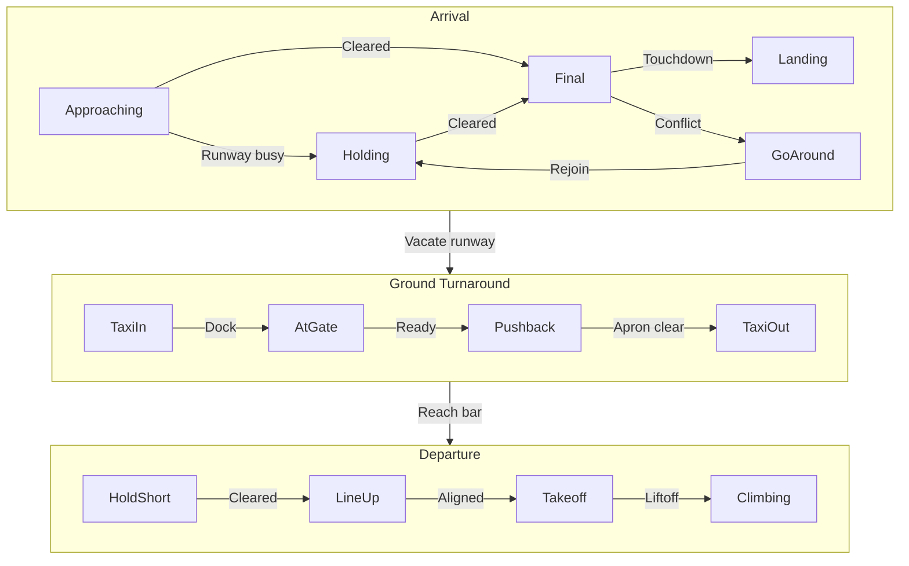
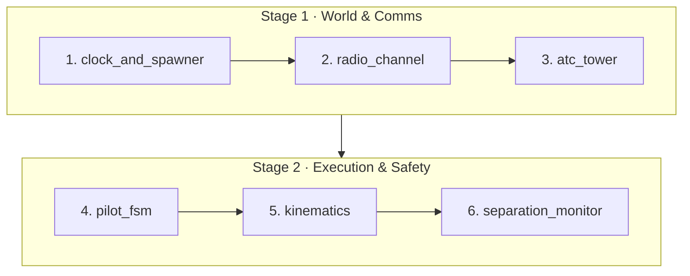
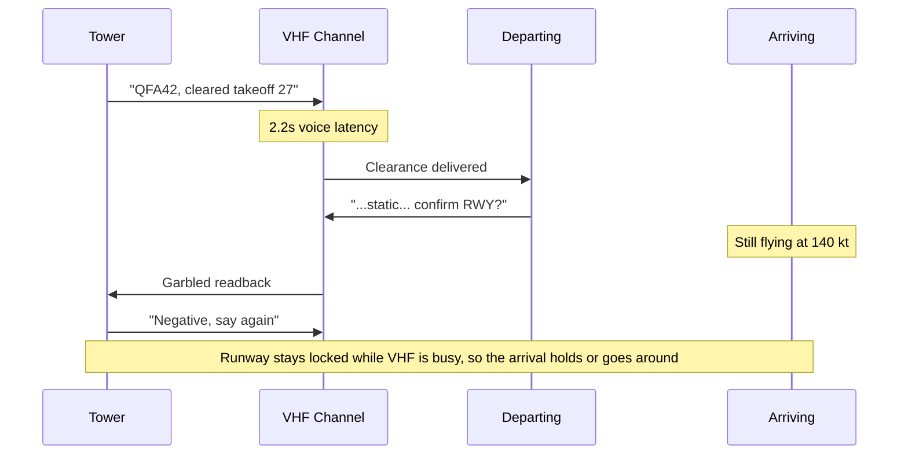

import AtcMiniScene from "../../components/AtcMiniScene.astro";
import AtcSandbox from "../../components/AtcSandbox.astro";

A while ago I was thinking about what an air traffic controller actually does all day, and I caught myself wondering whether the whole job is already a solved problem in mathematics and computer science.

On paper, an airport looks remarkably clean. You have known entities: aircraft, runways, taxiways, gates, and a control tower. You have known states: approaching, holding, landing, taxiing, parked at a gate, pushing back, lining up, and taking off. You know the physical geometry of the airfield, how long it takes a plane to brake and clear a strip, and how far apart aircraft need to stay. Even the communication protocol is something humans got to design from scratch.

Look at it through a software engineering lens and everything maps neatly to textbook ideas. Only one plane can use a runway at a time, which is a mutex. Planes waiting to land or take off form queues, which is queuing theory. Getting from a runway exit to an open gate is shortest-path routing on a small graph.

Instead of leaving it as a thought experiment, I decided to build a miniature airport to test the hunch.

Every 3D scene in this post is powered live in your browser by a small Entity Component System written in Rust and compiled to WebAssembly, with Three.js drawing the cartoon airfield on top. The point wasn't to recreate real aviation software. I wanted to see how far the neat computer science model gets you, and where the real world starts fighting back.

## The tidy version of an airport

Start with the simplest possible airfield: a single runway (`RWY 27`), one parallel taxiway, four terminal gates, clear weather, and almost instant radio communication.

In that setting, an aircraft's entire visit to the airport fits cleanly into a finite state machine:



Every move between states has a clear rule. An arriving aircraft can only turn onto `Final` once the tower clears it to land and locks the runway. Once it touches down and rolls off onto the taxiway, it releases the runway and triggers a short wake-turbulence buffer before the next plane can use the tarmac.

When the runway is dry and the radio has practically no lag, the whole airfield hums along like clockwork. Watch the glowing edge strips along the runway below. Green means the runway is free, purple means an arriving plane holds the landing lock, amber means a departing plane holds the takeoff lock, and blue shows the brief wake buffer after a plane clears out.

<AtcMiniScene
  preset="happy-path"
  title="1. The Happy Path: Finite State Machine & Runway Mutex"
  hint="Drag to orbit · Click any plane to inspect its live Rust ECS state"
/>

If every afternoon at an airport looked like that, you really could hand the tower over to a few hundred lines of Rust and go home early.

## Building it safely in Rust with a small ECS

Before breaking the simulation on purpose, it is worth looking at how you structure code when double-booked resources and invalid states carry real consequences.

Air traffic control maps nicely onto an Entity Component System (ECS), the pattern [Bevy](https://bevyengine.org/) has made popular in Rust. Rather than building deep inheritance hierarchies for different aircraft types, you break the world into three simple parts:

1. **Entities** are plain integer IDs (`Entity(42)`).
2. **Components** are small data structs attached to those IDs (`Transform`, `Kinematics`, `AircraftInfo`, `FlightState`).
3. **Systems** are plain functions that run in a fixed order on every tick, reading shared **Resources** (like `RunwayLocks`, `RadioFrequency`, and `Weather`) and **Events**.

I hand-rolled a tiny ECS with zero external dependencies so the code stays readable from top to bottom. On every tick, the simulation runs six systems in order:



Rust is a natural fit for this kind of state management. You get memory safety and no surprise garbage-collection pauses, of course, but the bigger day-to-day win is being able to keep your core invariants in one place and let the compiler enforce how they are used.

Here is the actual runway lock code running in the browser simulation right now:

```rust
#[derive(Debug, Clone, Copy, PartialEq, Eq)]
pub enum RunwayPurpose {
    Landing,
    Takeoff,
}

#[derive(Debug, Clone, Copy, PartialEq, Eq)]
pub struct RunwayLease {
    pub holder: Entity,
    pub purpose: RunwayPurpose,
    pub runway: RunwayId,
}

impl RunwayLocks {
    /// Attempts to acquire exclusive access to `runway`.
    /// Returns `Err(holder)` if the runway (or an intersecting runway) is busy.
    pub fn try_acquire(
        &mut self,
        layout: AirfieldLayout,
        runway: RunwayId,
        holder: Entity,
        purpose: RunwayPurpose,
    ) -> Result<RunwayLease, Option<Entity>> {
        let idx = runway.index();
        if let Some(existing) = self.leases[idx] {
            return if existing.holder == holder {
                Ok(existing)
            } else {
                Err(Some(existing.holder))
            };
        }
        if self.wake_cooldown[idx] > 0.0 {
            return Err(None);
        }

        // Cross-runway exclusion: RWY 27 and RWY 18 intersect.
        if layout == AirfieldLayout::IntersectingRunways {
            let crossing = match runway {
                RunwayId::Rwy27 => Some(RunwayId::Rwy18),
                RunwayId::Rwy18 => Some(RunwayId::Rwy27),
                RunwayId::Rwy27R => None,
            };
            if let Some(other) = crossing {
                if let Some(existing) = self.leases[other.index()] {
                    return Err(Some(existing.holder));
                }
                if self.wake_cooldown[other.index()] > 0.0 {
                    return Err(None);
                }
            }
        }

        let lease = RunwayLease { holder, purpose, runway };
        self.leases[idx] = Some(lease);
        Ok(lease)
    }
}
```

That single `try_acquire` function guards two rules at once: no two planes can share a runway, and when we turn on intersecting runways later, crossing flights on `RWY 27` and `RWY 18` cannot overlap either.

### Safety vs. liveness, and deterministic replay

In formal methods, distributed systems people split correctness into two halves: **safety** (nothing bad ever happens) and **liveness** (something good eventually happens).

A runway mutex gives you safety. You could achieve 100% safety tomorrow by closing every runway permanently, except liveness would drop to zero and every aircraft in the sky would run out of fuel. The whole craft of air traffic control sits on the knife edge between the two: pushing runway utilisation as high as possible without ever violating a separation rule.

There is another reason a small, deterministic ECS works well for safety-critical design. Because every component store uses a `BTreeMap<Entity, T>` (never a randomly seeded hash map) and the random number generator is a seeded `xorshift64`, every run is 100% reproducible. If a near-miss turns up at tick 2,840, you can replay that exact 64-bit seed frame for frame and lock it into a unit test. Real aviation engineering leans heavily on that same idea, using Monte Carlo simulation and formal model checkers like TLA+ and UPPAAL to exhaustively probe edge cases before touching live airspace.

There is just one problem with all of that neatness.

The Rust compiler can guarantee that the tower's internal state never double-books a runway. It cannot make a real airplane three kilometres out on final approach instantaneously know what the tower just decided.

## Where the tidy model starts to crack: shared radio lag

In a normal program, changing an object's state is atomic and instant. At an airport, the tower and the pilots do not share memory.

They talk over a single, half-duplex VHF voice frequency. Only one person can speak at a time. Every instruction takes a couple of seconds to say, hear, and read back. If static clips a callsign or a pilot mishears a runway number, the tower has to jump back on the radio and ask them to say it again while everyone else waits for their turn to talk.



To model this honestly, `atc_tower_system` is not allowed to change a pilot's `FlightPhase` directly. All it can do is push a `RadioTransmission` onto the shared `RadioFrequency` queue and wait for `radio_channel_system` to deliver messages one at a time:

```rust
// Half-duplex: only the front transmission actively occupies the frequency.
if let Some(front) = world.radio.queue.first_mut() {
    front.elapsed += dt;
    if front.elapsed >= front.total_delay {
        front.delivered = true;
        world.delivered_radio.send(DeliveredMessage {
            target: front.target,
            from_tower: front.from_tower,
            intent: front.intent,
            clearance_seq: front.clearance_seq,
            is_error: front.is_error,
        });
    }
}
```

In the diorama below, the curved dashed arcs and travelling ripples between the control tower and each plane are live radio transmissions in flight. Purple means a clearance from the tower, green means a pilot readback, amber means a garbled readback, and red marks an urgent go-around call. Watch the `120.5 MHz` status badge above the transcript flicker between `IDLE` and `TX` as transmissions queue behind one another.

Try pushing the **Radio Latency** slider up towards `3.5s` and watch the VHF transcript back up while the aircraft keep moving through the sky:

<AtcMiniScene
  preset="radio-lag"
  title="2. Half-Duplex Radio Latency & Readback Garbles"
  hint="Slide Radio Latency up and watch clearances fall behind moving aircraft"
/>

This is where the "it's just a state machine" idea starts to bend. In ordinary software, when a lock is contended, a thread calls `await` and sits quietly in memory at practically zero cost. You cannot `await` in mid-air. A 70-tonne airliner has a minimum stall speed, continuous forward momentum, and a ticking fuel gauge. Every blocked state in an airborne state machine has to pair with a physical escape hatch: a holding stack with vertical flight levels, a missed-approach climb, or a diversion airport.

## Rain, braking distance, and runaway queues

The next crack comes from physics leaking straight into the schedule.

On a dry strip, a plane touches down, brakes quickly, and turns off onto the taxiway. Switch the weather to rain or a storm and three things shift at once inside the simulation:

- **Braking grip drops** (`Clear: 1.0`, `Rain: 0.64`, `Storm: 0.48`), so planes spend longer rolling down the runway and keep the runway lock held longer.
- **Spacing widens** (`1.0×` in clear skies, `1.32×` in rain, `1.68×` in a storm), cutting the number of arrivals the runway can accept per hour.
- **Ground taxiing slows down**, building nose-to-tail lines along the taxiway and slowing gate turnarounds.

Anyone who has studied queuing theory knows what happens when a system runs close to capacity and service times creep up: queues do not grow smoothly, they pile up fast. One long wet rollout pushes the next arrival into the overhead holding stack, which generates extra radio calls, which delays the next takeoff clearance, which clogs the gates.

Switch between **Clear**, **Rain**, and **Storm** below, or nudge the **Traffic Rate** up, and watch the 3D holding stack build overhead:

<AtcMiniScene
  preset="weather-cascade"
  title="3. Weather & Cascading Queues"
  hint="Toggle Rain or Storm and watch the 3D holding stack grow overhead"
/>

## Wake turbulence and why first-come, first-served isn't optimal

If you click around the planes in any of these scenes, you will notice the simulation spawns three different aircraft classes: smaller regional twin-props (`RegionalProp`), standard narrow-body jets (`NarrowBody`), and heavy four-engine wide-bodies (`WideBody`).

In real aviation, mixed fleets break one of the simplest scheduling intuitions in computer science: first-come, first-served (FIFO). A heavy wide-body leaves violent wingtip wake vortices hanging in the air behind it. A small regional prop following a wide-body needs a much wider gap than two props or two wide-bodies landing back to back. Our Rust scheduler models this directly with a per-class wake separation bonus (`RegionalProp: +0`, `NarrowBody: +2.5`, `WideBody: +6.0`).

That small physical detail changes the maths completely. Because the required gap between plane A and plane B depends on their *ordering*, finding the highest-throughput arrival sequence stops being a simple FIFO queue and turns into a sequence-dependent scheduling problem closely related to the Travelling Salesman Problem. Real arrival managers reshuffle incoming banks miles before the airport specifically to group similar weight classes together and reclaim lost runway slots.

## Your turn in the tower

So far we have only looked at a simple single-runway strip with four gates. Real airports try to buy back headroom by pouring more concrete: adding a parallel runway to split arrivals and departures, or building an intersecting crosswind runway that creates a fresh mutual-exclusion puzzle right where the two strips cross.

Here is the full sandbox hooked up to the same compiled Rust ECS. You can swap the airfield geometry live between **Single (`RWY 27`)**, **Parallel (`27` and `27R`)**, and **Intersecting (`27` + `18`)**, scale active gates from 2 to 6, adjust separation minima, dial weather and radio latency, or throw curveballs like a low-fuel priority wide-body or a sudden burst of arrivals.

Try switching from **Single** to **Parallel** during a rainy rush hour to see how much pressure a second strip relieves, then switch to **Intersecting** and watch the glowing crossing box coordinate traffic across both runways:

<AtcSandbox />

## What computer science solves, and why people are still in the tower

After building and poking at this little airport, my original hunch feels half right and half naive.

Computer science and maths really have solved large chunks of air traffic control. Software is far better than a human at projecting four-dimensional trajectories, catching separation conflicts minutes early, and optimising arrival and taxiway sequences. Aviation is even tackling the half-duplex radio bottleneck directly with **CPDLC** (Controller-Pilot Data Link Communications), moving routine clearances off voice channels onto typed, acknowledged digital messages.

The hard part is everything that happens at the messy edge outside the formal model:

1. **Degraded sensors:** Real controllers have to stay safe when a transponder cuts out, weather clutters a radar return, or what a pilot reports does not match what is on the screen.
2. **Actors leaving the script:** A pilot misses an exit, spots birds on short final, declares a medical diversion, or accidentally rolls past a hold-short line. State machines assume every actor follows the transition table; real towers earn their keep when someone steps off the graph completely.
3. **Negotiating around ambiguity:** When a storm cell sits right across the approach path, pilots and controllers improvise vectors together in ways no fixed waypoint list ever anticipated.
4. **Accountability:** When an edge case lands outside every pre-written rule, a human still has to make the call and own it.

That is a pattern I keep running into with Rust, much like when I [went looking for Pydantic in Rust](/articles/i-went-looking-for-pydantic-in-rust). Strong types, explicit ownership, and deterministic ECS schedules wipe out whole classes of avoidable bugs inside your code's boundary. They make the happy path and every expected failure mode rock solid.

They just can't stop the rain from making the runway slick, or stop two people from keying the microphone at the same time.

---

## Addendum: Running real Rust in the browser with WebAssembly

When I first planned this post, I considered writing the interactive simulation in TypeScript and putting illustrative Rust snippets into the article. I am glad I went the extra step and compiled the real Rust crate instead. Code samples that never run have a way of drifting out of sync with the text, and shipping actual Rust to the browser turned out to be much simpler than I expected.

### Skipping the heavy WASM toolchain

Most Rust-to-WebAssembly guides reach straight for `wasm-bindgen`, `wasm-pack`, and `serde`. Those tools are handy for large web apps, but for a compact simulation inside an Astro article they add a lot of moving parts to maintain over the years.

Instead, `crates/atc-sim/` has zero third-party dependencies in `Cargo.toml`, not even `rand` or `serde`. It compiles straight to Rust's built-in `wasm32-unknown-unknown` target using plain `#[no_mangle] pub extern "C"` functions and release size flags (`opt-level = "z"`, `lto = true`, `strip = true`, `panic = "abort"`):

- **Compiled `.wasm` size:** **143.0 KB raw** (**42.8 KB Brotli**).
- **Local build time:** about 1 second with `cargo build --release --target wasm32-unknown-unknown`.
- **Simple deploys:** A tiny helper script (`npm run build:atc-sim`) copies the compiled module into `public/wasm/atc_sim.wasm`, so production builds stay plain Node and Astro with no Rust toolchain needed on Vercel. Because Three.js and the WASM loader are only imported by this article's components, the rest of `danferg.com` carries zero extra bytes.

### Passing frame state to Three.js without JSON

Rather than serialising JSON across the WebAssembly boundary 60 times a second, each Rust `SimInstance` packs the world into a reusable flat `Vec<f32>` buffer: a 24-float header of metrics and runway lock states, followed by 16 floats per aircraft and 8 floats per active radio pulse.

On the JavaScript side, TypeScript asks WASM for the buffer pointer and length, wraps a `Float32Array` view directly over `wasm.memory.buffer`, and updates the Three.js meshes in place:

```ts
const ptr = this.wasm.sim_snapshot_ptr(this.handle);
const len = this.wasm.sim_snapshot_len(this.handle);
const view = new Float32Array(this.wasm.memory.buffer, ptr, len);
```

Because the Rust crate stores simulations in a small handle table (`sim_create(preset) -> u32`), all four dioramas on this page share one downloaded `atc_sim.wasm` file while each runs its own independent ECS world. When a scene scrolls out of view, an `IntersectionObserver` pauses both the Rust tick loop and WebGL rendering so your browser stays quiet while you read.
